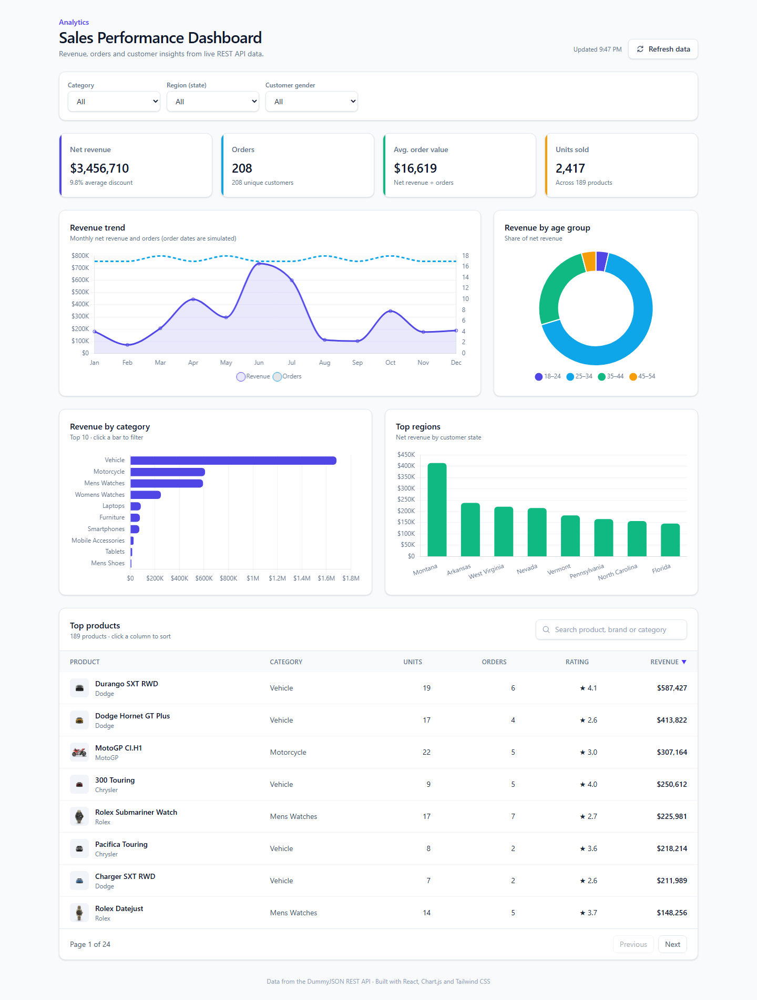

# Sales Analytics Dashboard

An interactive sales analytics dashboard built with **React**, **Chart.js** and **Tailwind CSS**. It pulls raw data from three REST endpoints (products, carts and users), joins it into a single analytics model, and presents KPIs, trends and breakdowns that update instantly as you filter.

**🔗 Live demo: [sales-analytics-dashboard-plum.vercel.app](https://sales-analytics-dashboard-plum.vercel.app)**



## Features

- **Live REST data:** fetches products, carts and users from the [DummyJSON](https://dummyjson.com) API in parallel, then joins them in the client.
- **KPI cards:** net revenue, orders, average order value, units sold, discount rate and unique customers.
- **Four Chart.js visualisations:**
  - monthly revenue vs. orders (dual-axis line chart)
  - revenue by category (horizontal bar chart; **click a bar to filter the whole dashboard**)
  - revenue share by customer age group (doughnut)
  - top regions by revenue (bar chart)
- **Global filters:** category, region (US state) and customer gender. Every chart, KPI and the table update together.
- **Top products table:** debounced search, sortable columns and pagination.
- **Loading, error and empty states:** skeleton placeholders, a retry button, and a "clear filters" prompt when nothing matches.
- **Responsive and accessible:** works from mobile to desktop; uses labelled form controls, `aria-sort` on table headers, `role="img"` + labels on charts, and visible focus rings.

## Performance: trimming unnecessary re-renders

The aim was to only re-render a component when the data it shows actually changes.

| Technique | Where | Effect |
|---|---|---|
| `useMemo` per aggregation | `App.jsx` | KPIs, monthly trend, category/region/age totals and product summaries each recompute only when their input changes. |
| `React.memo` on every chart, KPI card, filter bar and the table | `components/` | Components skip rendering when their props are the same. |
| `useCallback` for handlers | `App.jsx`, `useDashboardData.js` | Stable function references keep memoised children from re-rendering. |
| Chart options defined at module level | `components/charts/*` | Chart.js receives the same options object every time, so it avoids full chart updates. |
| Search state kept inside the table and debounced (250 ms) | `TopProductsTable.jsx` | Typing re-renders only the table, never the charts or KPIs. |
| Request cache that stores the promise | `api/client.js` | React StrictMode's double effects and remounts don't send duplicate network requests. |
| Tree-shaken Chart.js registration | `chartSetup.js` | Registers only the chart elements actually used, instead of `chart.js/auto`. |

To verify, open React DevTools → Profiler, enable "Highlight updates when components render", and type in the product search. Only the table highlights.

## Tech stack

React 19 · Vite 6 · Chart.js 4 + react-chartjs-2 · Tailwind CSS 4 · Fetch API

## Getting started

```bash
npm install
npm run dev        # http://localhost:5173
npm run build      # production build in dist/
npm run preview    # serve the production build
```

Optional: copy `.env.example` to `.env` and point `VITE_API_BASE_URL` at another API with the same shape.

## Project structure

```
src/
├── api/client.js              # fetch wrapper + request cache
├── hooks/
│   ├── useDashboardData.js    # parallel loading, error handling, refresh
│   └── useDebouncedValue.js
├── utils/
│   ├── transform.js           # pure join/filter/aggregate functions
│   ├── format.js              # Intl currency/number/percent formatters
│   └── colors.js
├── components/
│   ├── charts/                # RevenueTrend, CategoryBar, AudienceDoughnut, RegionBar
│   ├── FilterBar.jsx, KpiCard.jsx, ChartCard.jsx
│   ├── TopProductsTable.jsx
│   └── StatusViews.jsx        # skeleton / error / empty states
├── chartSetup.js
└── App.jsx
```

## Data notes

- Each cart from DummyJSON is treated as one order; the cart's `userId` links it to a customer's age, gender and state.
- **DummyJSON carts have no timestamps**, so each order gets a deterministic simulated month (`(id × 7) mod 12`) to drive the trend chart. Swap this out for real dates when you connect a real API.
